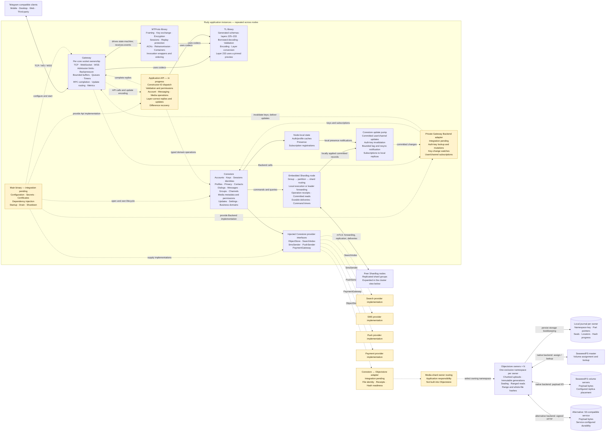
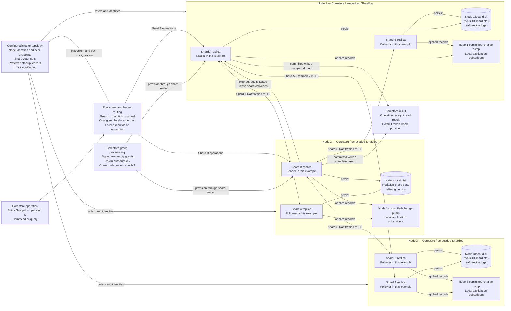

# Rudy

**Telegram-compatible infrastructure, built in Rust.**

Rudy provides the protocol, networking, and storage foundations for a Telegram-compatible server: layer-aware TL codecs, server-side MTProto, a bounded network gateway, sharded application storage, and media storage.

The main application composes these components. It supplies API handlers, storage adapters, configuration, and lifecycle management. Protocol handling stays separate from application policy, and the public gateway does not depend on the private application database.

## Repositories

| Repository | Purpose |
|---|---|
| [tl](https://github.com/rudy-chat/tl) | TL schema generation, validation, borrowed codecs, and conversion across layers 225–233. |
| [mtproto](https://github.com/rudy-chat/mtproto) | Bounded, sans-I/O implementation of server-side MTProto 2.0. |
| [gateway](https://github.com/rudy-chat/gateway) | Linux network gateway for TCP, WebSocket, and secure WebSocket connections. |
| [corestore](https://github.com/rudy-chat/corestore) | Typed application storage over an embedded, sharded, replicated storage engine. |
| [objectstore](https://github.com/rudy-chat/objectstore) | Chunked media storage, upload sealing, ranged reads, and integrity verification. |

The application API, server composition, and private adapters connect these components into a server. Corestore embeds **Shardlog**, which supplies shard routing, Raft replication, persistent state, and durable work.

**Repository access:** The repositories are temporarily private during internal development and restructuring. Public access will be restored as they are ready.

## Architecture

These diagrams distinguish existing component contracts from unfinished server integration. **Solid arrows show implemented calls, dependencies, or storage paths. Dashed arrows show integration that remains to be completed.** They describe the code architecture, not a claim that a complete production deployment is running.

### Application, protocol, and media paths

Each application instance owns its connections and local runtime state. Its main binary supplies the API and backend implementations; the gateway never opens or configures Corestore itself.

Corestore invokes media storage through its injected `ObjectStore` provider. The adapter to the standalone Objectstore crate is a separate integration task. Media bytes do not travel through the replicated application-state log; Corestore persists the application metadata, references, and receipts needed to use them.

### Sharding, replication, and cluster traffic

Corestore assigns application state to **entity groups**: users, chats, channels, index buckets, media buckets, allocator groups, and the control group. The routing map places their partitions onto shards. **Each shard is a separate Raft group**, with its own leader and configured voters.

The following is an illustrative **two-shard, three-node configuration**. Leaders are spread across nodes; followers hold replicas of the same shards. These are the storage roles of Corestore/Shardlog nodes, not an additional mandatory service tier. Replica count and placement come from configuration.

Writes require a majority of the shard's voters. In this three-voter example, the majority is two. Raft manages elections and replication; leader positions in the diagram can change. Application results and committed-change notifications follow the relevant commit/application progress.

Cross-entity effects use durable, ordered, deduplicated deliveries. This does not make every multi-entity application operation one atomic distributed transaction.

### Storage and ownership boundaries

| Concern | Owner |
|---|---|
| Sockets, connection admission, send queues, backpressure, and reply routing | Gateway |
| Wire encryption, protocol sessions, replay checks, ACKs, and retransmission | MTProto, driven by Gateway |
| Schema validation, decoding, encoding, and layer conversion | TL |
| RPC permissions, method behavior, response construction, and difference recovery | Application API |
| Durable auth keys, identities, messages, permissions, media references, and update history | Corestore |
| Entity routing, shard replication, persistent state/logs, deliveries, and command timers | Embedded Shardlog |
| Media bytes, immutable parts, upload seals, range reads, and integrity hashes | Objectstore and its selected storage backend |
| Objectstore namespace ownership, owner routing, and journal recovery placement | Embedding application and deployment |
| Node configuration, provider implementations, secrets, and component lifecycle | Main application |

Objectstore sharding is independent of Corestore sharding. Each Objectstore owner exclusively opens one namespace journal; different owners can run on different nodes. The journal contains storage bookkeeping, not the payload bytes. SeaweedFS or the selected S3-compatible service stores those bytes and supplies its configured durability. The native SeaweedFS path uses the master and volume servers directly, without a filer.

## Components

### TL

A schema generator and bounded, layer-aware codec implementation for Telegram API layers **225–233**. Layer 233 uses a pinned preview schema; layers 225–232 have official client schema sources.

TL provides borrowed object views, checked encoding and decoding, typed RPC results, and explicit cross-layer conversion. It owns no connections, cryptographic keys, protocol sessions, or application storage.

### MTProto

A bounded, sans-I/O implementation of server-side **MTProto 2.0**.

It implements transport framing, cryptographic handshakes, encrypted messages, session protocol state, replay checks, acknowledgements, retransmission, and invocation wrappers. Callers supply I/O, time, entropy, storage interfaces, and scheduling. Protocol state is distinct from durable application state.

### Gateway

A Linux network edge supporting **TCP, WebSocket, and WSS**. Each socket stays on its accepting I/O core, while shared session ownership and bounded command queues coordinate work between cores.

Gateway enforces admission and resource limits, drives MTProto, delivers calls to the supplied API, and routes replies and live updates. Its `Backend` interface abstracts durable keys and subscriptions. The private application implements that interface; Gateway has no direct Corestore or Shardlog dependency.

### Corestore and Shardlog

Corestore exposes typed application operations for accounts, authentication, profiles, privacy, contacts, dialogs, messages, groups, channels, media metadata, and other application domains. It also exposes injected interfaces for media storage, search, SMS, push notifications, and payments.

Corestore embeds Shardlog. Entity groups route to shards; each replicated shard has its own Raft group. Shardlog persists application state in RocksDB and replication logs in raft-engine. Corestore uses operation receipts for retries, committed read tokens, durable cross-entity deliveries, and command timers.

Standalone mode runs local shards without machine redundancy. Cluster mode configures replica placement, peer identities, mTLS connections, and leader forwarding.

### Objectstore

An async media-storage component with **native SeaweedFS and S3-compatible backends**.

It supports chunked uploads, immutable part generations, durable upload sealing, ranged downloads, SHA-256 range verification, and background whole-file hashing. Each owner keeps an exclusive local journal of namespace identity, locators, part pointers, seals, and hash progress.

Corestore owns user-visible media metadata, access rights, message references, and stored receipts. Objectstore owns byte storage and the bookkeeping required to recover and serve those bytes.

## Principles

- **Explicit ownership:** The main application owns configuration, dependency injection, provider implementations, and lifecycle.
- **Clear component boundaries:** Protocol handling, networking, application policy, structured storage, and media storage have separate responsibilities.
- **Bounded resources:** Connections, queues, buffers, outstanding calls, storage admission, and background work have explicit limits.
- **Layer-aware compatibility:** Requests and results use the client's schema layer, with explicit conversion where supported.
- **Sharding with replication:** Routing distributes entity groups across shards; each shard's voter set provides its replication and majority requirement.
- **Durable effects:** Application writes, operation receipts, cross-entity deliveries, and update recovery have explicit persistence contracts.
- **Independent validation:** Component tests use independent implementations, including grammers, Telethon, and TDLib. Component interoperability does not imply complete Telegram API coverage.

## Status

**Active development. Rudy is not yet a complete Telegram server implementation.**

The protocol, gateway, and storage components are developed and tested independently. The application API, production provider adapters, server composition, and full end-to-end integration remain in progress.

The architecture diagrams intentionally preserve these current limitations:

- **Server wiring:** The main binary, application API handlers, private Gateway backend adapter, and Corestore-to-Objectstore adapter are not presented as completed integration.
- **Live state:** Gateway connections and live protocol sessions are in memory. Corestore presence is currently node-local. Its current committed-change subscriptions require a locally hosted replica; a general remote per-node feed is not wired into this integration.
- **Cluster management:** Corestore currently uses its pinned Shardlog integration, configured placement, and signed group provisioning. Newer meta-shard, balancer, and per-node feed integration are not shown as deployed features.
- **Media ownership:** Objectstore does not provide an automatic cross-node owner router or active-active access to a shared namespace journal. Payload replication does not replace preservation of that journal and its namespace key.
- **Operations:** Storage-engine backup and state-transfer capabilities are not a claim that production backup scheduling, restore orchestration, or automated rebalancing has been configured.

Full Telegram API coverage, application services, deployment configuration, and operational qualification remain under development. Public repository access will be restored after the ongoing internal work is ready.

---

An independent project, unaffiliated with Telegram.
